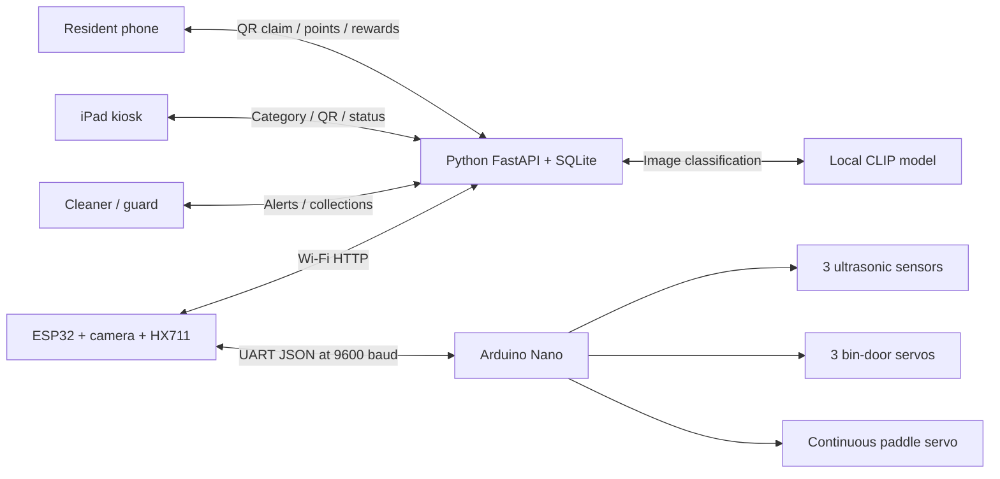
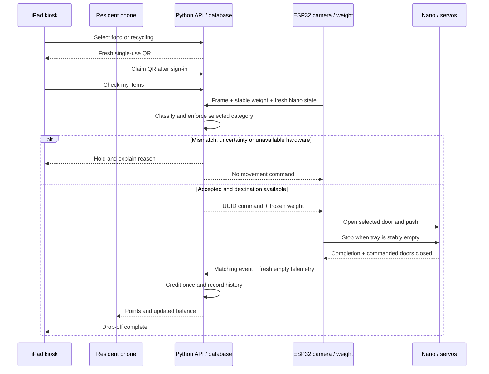
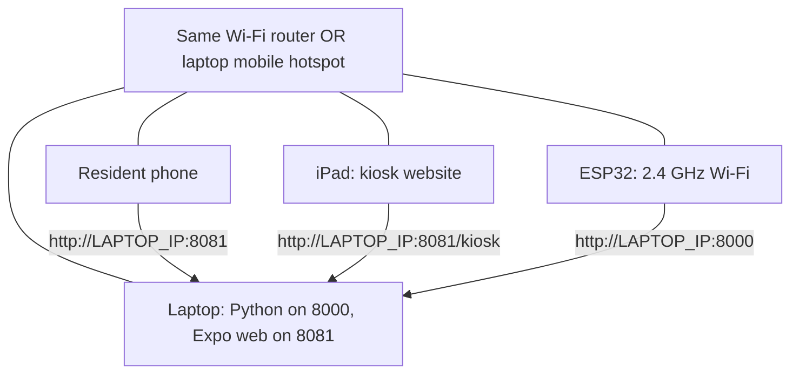

# Sime Loop

A hackathon prototype that turns correctly sorted community waste into rewards. **Residents** use an Expo React Native app, an **iPad kiosk** starts each drop-off, and an **ESP32 + Arduino Nano** station verifies the category and weight before sorting. **Cleaners/guards** receive collection tasks when a compartment fills up.

The reward concept is vouchers at Sime Darby Property destinations, including malls and food/drink outlets. All offers, accounts, locations and community data supplied here are demonstrations; vouchers are not redeemable with real merchants.


**Start here:** [Run the project](#run-the-project) · [Connect Wi-Fi / hotspot](#connect-the-phone-ipad-and-bin) · [Hardware setup](#connect-the-hardware) · [Visual walkthrough](docs/VISUAL_GUIDE.md) · [Current firmware/API handoff](iot/SMARTBIN_HANDOFF.md)

## What is included

| Part | What it does |
| --- | --- |
| Resident app | Dashboard, Malaysia/nearby station map, QR claim, points, rewards, earned/redeemed history, user/township leaderboards and profile |
| Cleaner/guard app | Township collection queue, task acknowledgement, collection completion and notifications |
| iPad kiosk website | Two waste choices, unique QR, camera-check/retry states, points confirmation, local leaderboard and three compartment levels |
| Python backend | FastAPI, persistent SQLite, authentication, rewards ledger, collection tasks, device protocol and local CLIP computer vision |
| ESP32 gateway | Wi-Fi, OV7670 camera, HX711 weighing, telemetry, server commands and Nano communication |
| Arduino Nano | Three ultrasonic sensors, three door servos, continuous paddle servo and local watchdog/interlocks |

| Resident app | Cleaner/guard app |
| --- | --- |
|  |  |

The [visual walkthrough](docs/VISUAL_GUIDE.md) includes all main app pages, the Malaysia map, QR pairing, mismatch/retry, points completion and wiring sheets.



## How a drop-off works

1. Pre-sort the waste, then select **Recyclables** or **Food waste** on the kiosk. A full destination blocks only that choice.
2. Scan the newly generated QR with the phone camera or app. Sign in as a resident to claim the deposit. The QR expires after 3 minutes; the claimed deposit lasts 15 minutes.
3. Put one clearly visible item, or a single visible layer, on the weighing plate. Press **Check my items** on the kiosk.
4. The ESP32 uploads a frame and fresh weight/controller readings. Python checks whether the image matches the chosen category. A mismatch or uncertain result shows a warning and keeps the door closed; remove the wrong item and retry.
5. A successful check authorizes one command. The Nano opens only the selected internal door and runs the paddle until the plate is stably empty, then stops and commands the door closed.
6. The server credits points once after matching controller-completion and empty-plate evidence. Weight is frozen **before** pushing: food earns **50 points/kg**, recyclables **100 points/kg**. A 500 g deposit earns 25 or 50 points respectively.
7. Full-bin readings create an area-scoped cleaner task. The other available destination continues operating.

The third compartment is **reject**. It is monitored, but the current two-button kiosk holds a wrong-category deposit for correction rather than automatically dumping it into reject. Existing explicit reject/demo paths award zero points.



## Run the project

### Requirements

- Git, **Node.js 22.14+**, **Python 3.14**, and [uv](https://docs.astral.sh/uv/getting-started/installation/).
- Internet for first dependency/model downloads. The CLIP model runs locally after downloading; map tiles and optional remote notifications still use the internet.
- Windows PowerShell instructions below. Keep two terminal windows open while demonstrating.

```powershell
git clone https://github.com/Kairu-6/SimeDarby2026.git
cd SimeDarby2026
.\scripts\setup.ps1

# Create local configuration only if it does not already exist.
if (!(Test-Path backend/.env)) { Copy-Item backend/.env.example backend/.env }
```

The setup installs backend/mobile dependencies and downloads `openai/clip-vit-base-patch32`. Cached files live under `.cache/`, not in Git. It may take several minutes on the first run. If PowerShell blocks scripts, use a process-scoped policy only for this terminal: `Set-ExecutionPolicy -Scope Process Bypass`.

**Terminal 1 — backend, database and model:**

```powershell
.\scripts\start-backend.ps1
```

**Terminal 2 — app and kiosk web development:**

```powershell
.\scripts\start-app.ps1 -Web -ApiUrl http://localhost:8000
```

| Open on the laptop | Address |
| --- | --- |
| Resident/cleaner app | http://localhost:8081 |
| iPad kiosk | http://localhost:8081/kiosk |
| Interactive API documentation | http://localhost:8000/docs |
| API health check | http://localhost:8000/api/health |

Use the quick demo buttons on the sign-in screen, or enter:

| Role | Email | Password |
| --- | --- | --- |
| Resident — Aina | `resident@simeloop.demo` | `Loop123!` |
| Cleaner/guard — Ravi | `cleaner@simeloop.demo` | `Loop123!` |

SQLite is created automatically at `backend/data/simeloop.sqlite3`. Balances, history, tasks and vouchers survive restarts. Each teammate's fresh clone gets an independent seeded database; sharing one running backend lets everyone see the same state. These shared test accounts represent one resident and one cleaner, so simultaneous resident deposits may conflict by design.

On macOS/Linux, run these in separate terminals instead:

```bash
cd backend
uv sync --extra vision
uv run --extra vision python scripts/warm_model.py
uv run --extra vision uvicorn app.main:app --host 0.0.0.0 --port 8000
```

```bash
cd mobile
npm ci
npm run web
```

Use the same `HF_HOME` for warming and serving if you override the model cache directory.

## Connect the phone, iPad and bin

The **laptop runs the backend and vision model**. Everyone must be able to reach its network address. `localhost` works only on that laptop; on a phone it means the phone itself.



### Option A — shared Wi-Fi router

Connect the laptop, iPad, phone and ESP32 to the same local network. Use a **2.4 GHz** SSID compatible with the ESP32. Avoid guest networks, campus captive portals and client/AP isolation, which can prevent devices from reaching each other.

### Option B — Windows laptop hotspot

1. Open **Settings → Network & internet → Mobile hotspot** on the laptop.
2. Set a network name and password. Choose **2.4 GHz** for the network band when available, then turn the hotspot on.
3. Connect the iPad, resident phone and ESP32 to that hotspot. The laptop is already its host; it does not join its own hotspot.
4. Run `ipconfig` and find the IPv4 address of the hotspot adapter, often named a Local Area Connection. It is commonly `192.168.137.1`, but use the address actually shown.
5. Keep the laptop awake and hotspot enabled. A phone hotspot can also work if it supports 2.4 GHz and communication between clients; verify it rather than assuming it allows peer traffic.

### Set the addresses

For the example below, suppose the laptop address is **192.168.137.1**. Replace it everywhere with your own address:

| Setting or device | Example |
| --- | --- |
| Python backend | `http://192.168.137.1:8000` |
| Resident/cleaner web app | `http://192.168.137.1:8081` |
| iPad kiosk | `http://192.168.137.1:8081/kiosk` |
| Backend `PUBLIC_APP_URL` | `http://192.168.137.1:8081` |
| ESP32 `API_BASE` | `http://192.168.137.1:8000` |

Edit **backend/.env** before restarting the backend:

```dotenv
# Demo controls stay enabled for a hardware-free demonstration.
DEMO_MODE=true
PUBLIC_APP_URL=http://192.168.137.1:8081
CORS_ORIGINS=http://localhost:8081,http://127.0.0.1:8081,http://192.168.137.1:8081
```

`PUBLIC_APP_URL` is essential: it makes the kiosk QR open the laptop-hosted resident app on the phone, rather than sending the phone to its own localhost. CORS entries are exact origins without a trailing slash.

Restart both terminals, using the LAN API address for the app:

```powershell
# Terminal 1
.\scripts\start-backend.ps1
```

```powershell
# Terminal 2
.\scripts\start-app.ps1 -Web -ApiUrl http://192.168.137.1:8000
```

Then open `http://192.168.137.1:8000/api/health` **on the phone**. Once it returns JSON, open the app URL and kiosk URL from the table. If an app has a saved old backend address, update its **Connection settings**; the kiosk has its own settings button too. A local `mobile/.env` or an existing terminal's `EXPO_PUBLIC_API_URL` can also override defaults.

If Windows Firewall prompts, allow the development Python/Node processes on the intended trusted network. If another device cannot connect, check the active firewall/network profile and inbound TCP **8000** and **8081**. Do not disable the entire firewall. Recheck `ipconfig` whenever you change networks.

**Scanning on local HTTP:** the phone's built-in camera can scan the QR displayed on the iPad and open its link. Browser camera scanning may require HTTPS; use the built-in camera, a native app build, or paste the QR link through the app's manual input. An HTTPS-hosted website also needs an HTTPS API; it cannot reliably call a laptop's plain-HTTP endpoint.

### Native Expo preview

With the API running and devices on the same network:

```powershell
.\scripts\start-app.ps1 -ApiUrl http://192.168.137.1:8000
```

Scan **Expo's development QR** to load the app. This is different from the **kiosk deposit QR**. The app targets Expo SDK 58 / React Native 0.88: use a compatible Expo Go or configure your own EAS preview build with `mobile/eas.json`. Native background push requires your Expo project/platform credentials. The supplied Android profile builds an APK; native binaries have not been installed or tested on a physical phone here.

## Five-minute hardware-free demonstration

1. Open the kiosk on the iPad and the resident app on a phone. Choose **Food waste** on the kiosk and scan the fresh QR. Sign in as the demo resident.
2. On the kiosk expand **Try without hardware**. Simulate a wrong category: the warning appears and the session stays on hold.
3. Simulate a matching category, then a **500 g** completion: the resident and kiosk show **+25 points**. This explicitly labelled simulation does not move a servo or use the camera.
4. In the resident app, explore the map, redeem an illustrative reward, then check History, Leaderboard and Profile. Spending points does not reduce lifetime leaderboard rank.
5. In another browser/sign-in session, use the cleaner account. **Simulate full bin** creates a collection task/notification; accept it and mark it cleared. Other compartments stay available.

The photo-check feature invokes actual model inference but does not award points by itself. See the [visual walkthrough](docs/VISUAL_GUIDE.md) for the screens and expected states.

## Connect the hardware

**Use the current paired sketches below.** The older `esp32_gateway/`, `nano_controller/`, `hx711_calibration/`, and standalone bin-controller examples are legacy experiments with different contracts or pins.

| Use this folder | Target |
| --- | --- |
| `iot/smartbin_esp32/` | NodeMCU-style ESP32, camera, HX711, Wi-Fi and UART gateway |
| `iot/smartbin_nano/` | Classic Arduino Nano / ATmega328P, sonar and servos |
| `iot/smartbin_hx711/` | HX711 diagnostics and known-mass calibration |


[Enlarge wiring SVG](iot/schematics/wiring-overview.svg) · [UART level divider and power sheet](iot/schematics/uart-and-power.png) · [Full source ZIP](iot/amended/SmartBin_Firmware_0.3.zip)

1. Follow the [current handoff](iot/SMARTBIN_HANDOFF.md). Install **ESP32 Arduino core 2.0.17**, **ArduinoJson 7.x**, **HX711 by Bogdan Necula**, and the Nano **Servo** library. Keep the included custom OV7670 driver: do not substitute an unrelated library with the same filename.
2. ESP32 `smartbin_esp32/config.h`: set `WIFI_SSID`, `WIFI_PASSWORD`, `API_BASE` to the laptop's port-8000 address, and `DEVICE_KEY` to match the backend's private `DEVICE_API_KEY`. `esp32-01` maps to station `ELM-01`.
3. Configure backend **backend/.env** with `DEMO_MODE=false`, a private `DEVICE_API_KEY`, a different private `KIOSK_API_KEY`, and the correct `PUBLIC_APP_URL` / `CORS_ORIGINS`. Leave `PUBLIC_PREVIEW=false` and `WEB_BUILD_PATH` empty for the normal hardware API. Restart it.
4. Pair the iPad through kiosk **Connection settings** using the LAN API URL, station `ELM-01`, and the separate `KIOSK_API_KEY`. Neither web build contains the device key.
5. Calibrate the HX711 with the empty tray and a known mass; copy the signed counts-per-gram factor into the gateway config. Measure each sonar's empty/full distances using `iot/station.example.json` and the configure-station script. Calibrate Nano door pulses, paddle neutral/direction and timeout for the actual mechanism.
6. Enable `HARDWARE_CONFIGURED` in both paired configs only after those checks, then upload to the actual board/USB port. Normal source defaults to disabled; never flash a `SIMELOOP_COMPILE_TEST` build with fake calibration.
7. Start with motor power disconnected to inspect live camera, weight and sonar readings. Test one supervised item and each failure/timeout path before attempting the full demonstration. Use a suitable separate servo supply, common ground, and the Nano-to-ESP32 voltage divider shown in the drawings.

**Physical mapping:** bin 1 = recyclable (door D8), bin 2 = food (D9), bin 3 = reject (D10); paddle D11. Nano UART RX D12 / TX A0 ↔ ESP32 TX17 / RX16, at 9600 baud. HX711 DOUT36 / SCK13. The wiring sheet lists all camera and sonar pins.

Real hardware uses the private/LAN Python endpoint. The public visual-preview profile and Pages proxy deliberately block device endpoints. Do not put Wi-Fi passwords, local configuration, device keys, Cloudflare tokens or populated databases into commits.

## Hosting and sharing websites

The resident/cleaner site and kiosk can be published as **two Cloudflare Pages projects**. Python/SQLite/PyTorch needs a separate running host; Pages serves the web exports and proxies their `/api/*` calls to that HTTPS host.

```powershell
wrangler login
wrangler whoami
.\scripts\deploy-pages.ps1 -ApiOrigin https://YOUR-PYTHON-API-HOST -AppUrl https://YOUR-RESIDENT-APP.pages.dev
```

To build both upload directories without publishing, add `-BuildOnly`. Configuration files in `deploy/pages/` contain an example API hostname; the script writes your supplied origin. After deployment, use the actual resident Pages URL for backend `PUBLIC_APP_URL` and the kiosk build's `EXPO_PUBLIC_APP_URL`. See [full deployment instructions](deploy/pages/README.md).

The laptop-only sample profile is also available:

```powershell
cd mobile
npm run export:web
cd ..
.\scripts\start-web-preview.ps1
```

It serves the app at `http://localhost:8003/` and kiosk at `/kiosk`, bound to loopback with its own sample database and **hardware endpoints disabled**. It is suitable as the target of an explicitly configured temporary tunnel. Tunnel URLs change on restart and need the laptop awake; they are not permanent deployment URLs.

## Project map

```text
backend/                 FastAPI, database, model, tests and CLI tools
mobile/                  Expo React Native app + web kiosk
iot/smartbin_esp32/       CURRENT gateway, including working camera driver
iot/smartbin_nano/        CURRENT Nano controller
iot/smartbin_hx711/       CURRENT calibration sketch
iot/amended/             Replacement firmware Markdown files + source ZIP
iot/schematics/          Wiring drawings (PNG/SVG) + generator
scripts/                 Setup, start, sample preview and Pages deployment
deploy/pages/            Public-web API proxy, configs and proxy tests
docs/images/             Shareable sample-data screenshots
docs/                    Visual walkthrough, model/push notes, verification
iot dev/                 Preserved earlier Python camera experiments
```

## Checks and current status

```powershell
cd backend
uv run pytest -q
uv run ruff check app tests scripts
uv run ruff format --check app tests scripts
cd ..\mobile
npm run typecheck
npm run export:web
npm run export:native
cd ..
node --test deploy/pages/worker.test.mjs
```

Verified: **41 backend tests**, **5 Pages-proxy tests**, lint, TypeScript, both web surfaces, Android/iOS Hermes exports, and compilation of the current ESP32/Nano/HX711 sketches. The actual copied camera driver was compiled with core 2.0.17. See [verification details](docs/VERIFICATION.md).

The software demo is runnable. Firmware has **not** been flashed or bench-tested. Remaining physical work includes scale/sonar calibration, camera colours/framing, servo geometry, UART reliability with servo interrupts, power and watchdog testing. No end-position or arrival switches are present, so an empty plate and commanded door-close are not proof of correct chute arrival.

CLIP is a real pretrained zero-shot classifier, not a waste detector trained or benchmarked on this enclosure. It cannot guarantee detection of small/hidden contaminants. Use a visible item/layer and evaluate labelled camera captures; see [vision evaluation](docs/VISION.md). In-app cleaner alerts work; closed-app push needs configured native credentials. Docker/Compose and CI are provided, but Docker has not been run here.

## Troubleshooting

| Symptom | Check |
| --- | --- |
| Phone cannot open API health | Laptop IP, same network, firewall ports, VPN and router client isolation |
| QR opens localhost on phone | Set backend `PUBLIC_APP_URL` to the LAN/HTTPS resident URL; restart and generate a fresh QR |
| Health works but app cannot log in | App Connection settings / `EXPO_PUBLIC_API_URL`, matching CORS origin, and stale browser settings |
| Native app cannot load | SDK compatibility, Expo development QR versus deposit QR, Metro port 8081 |
| Browser camera is unavailable | Use system camera to scan the kiosk, native preview, manual QR link input or HTTPS |
| ESP32 cannot join Wi-Fi | 2.4 GHz, SSID/password, signal, captive portal and hotspot band |
| Kiosk says pairing required | Use its separate kiosk key and correct station/API settings |
| Model unavailable or first check slow | Complete setup/model warm-up, keep the same model cache, inspect backend terminal |
| Check stays on hold | Read the reason: wrong category, stale sensors, uncalibrated/unstable scale, offline Nano or full destination |
| Public preview rejects device calls | Expected; point the ESP32 at the normal LAN API on port 8000 |
| Different balances across devices | Ensure all devices use the same backend/database; screenshots show illustrative previous demo states |
