# Sime Loop — visual walkthrough

Use this page to explain the prototype to teammates or judges. These are screenshots of the running software with **sample data**, not design mockups. Balances and collection counts reflect different test moments. The pictured QR is expired; generate a new one in your running kiosk.

## 1. A resident's everyday app

The dashboard shows points, personal activity and the route into a deposit. Its station map supports nearby and Malaysia views, with available, full and busy states. Rewards, history, leaderboards and profile are available from the navigation.

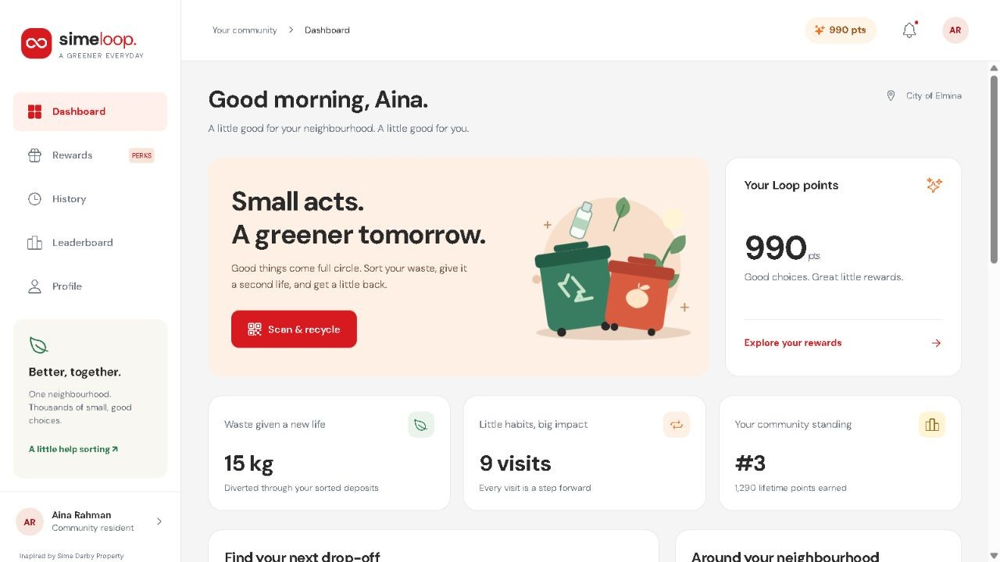

The Malaysia map puts the local network in context. Green stations are available, red indicates a full compartment, and orange indicates an active deposit. These are seeded example locations.

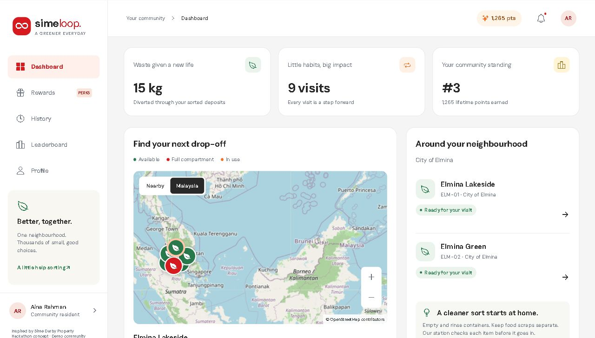

## 2. The station starts on the iPad

Two large choices keep the public screen simple: **Recyclables** and **Food waste**. The right side shows the local sample leaderboard and independent capacities for recycling, food and reject. A full bin blocks its own destination.

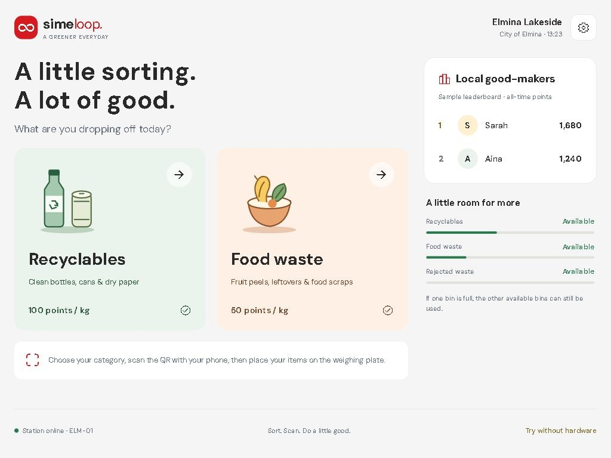

The same web surface also stacks on a phone. The kiosk is intended for landscape iPad use; smaller screens scroll vertically.

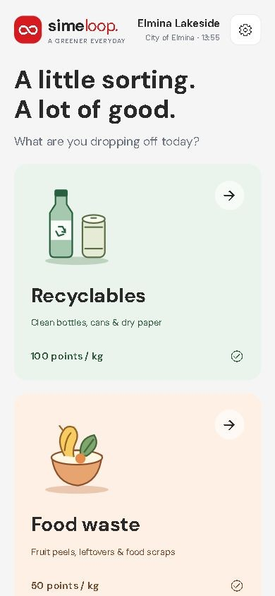

## 3. A fresh QR connects the deposit to the resident

After selecting a category, the server creates a single-use QR. Scanning opens the resident app; sign-in claims this deposit for that resident. A static printed station QR cannot replace this category-specific claim.

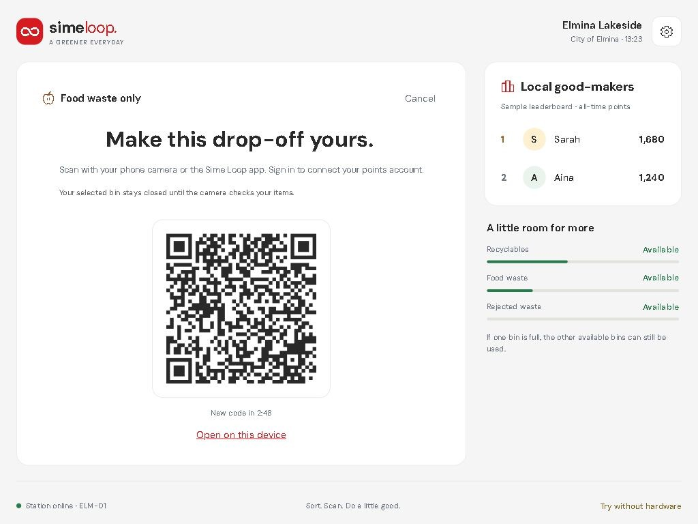

The category is locked to the session. Selection reserves the destination; the internal door opens only after an accepted check and healthy hardware readings.

## 4. Wrong category means hold and retry

The user places visible items on the plate and requests a check. In this screenshot, the labelled demo controls simulate a mismatch. The warning explains that the food-only session cannot accept the incorrect items, and no sorting command is issued.

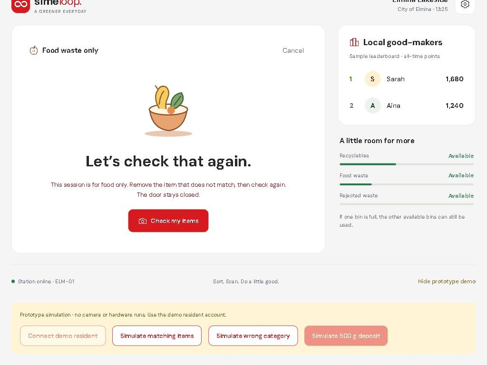

Real mode uses the ESP32 camera and local Python model. A retry requires removing the offending item and pressing **Check my items** again. An uncertain result, unhealthy scale or stale/offline controller also holds the deposit.

## 5. Verified weight becomes points

The illustrated demo completes 500 g of food for **25 points**. A real completion requires the matching Nano event and fresh stable-empty plate telemetry; the server uses the weight measured before pushing and credits once.

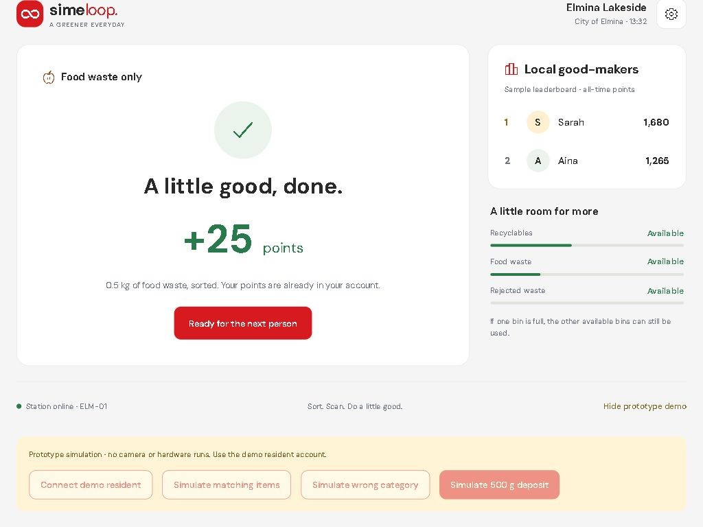

The connected resident sees the same completed deposit. Points then support illustrative reward redemptions; earned and spent events remain in History.

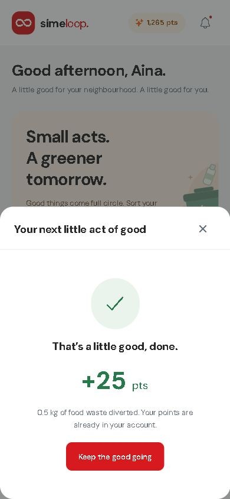

### Rewards and history

The rewards catalogue shows the available balance, point costs and example mall offers. These are illustrative offers, with no merchant redemption integration.

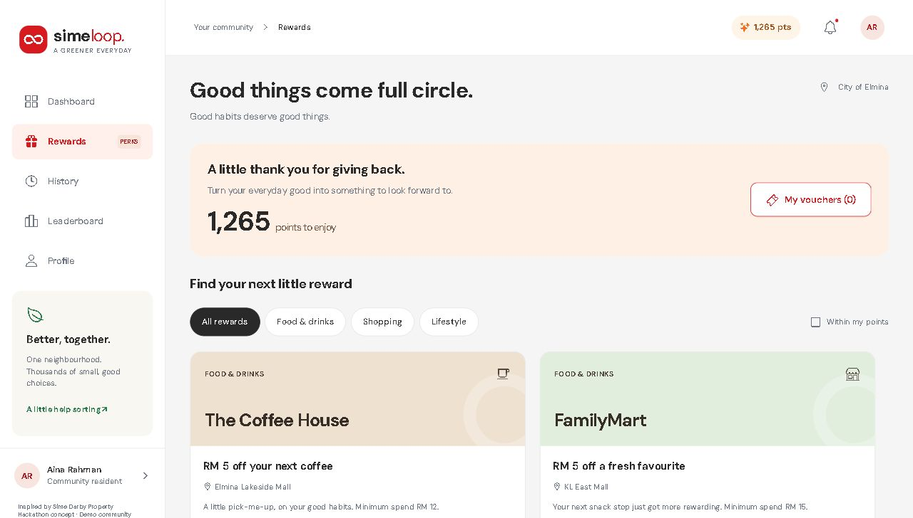

History separates earned points from redeemed rewards and offers activity/month filters. This capture is before any reward redemption on the isolated preview database.

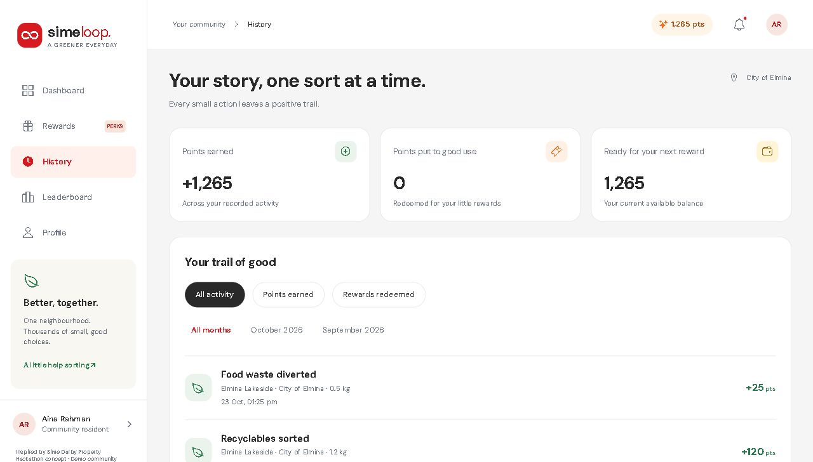

### Resident and township rankings

Rankings use all-time earned points, so spending a balance does not reduce leaderboard standing. Switch between people and townships.

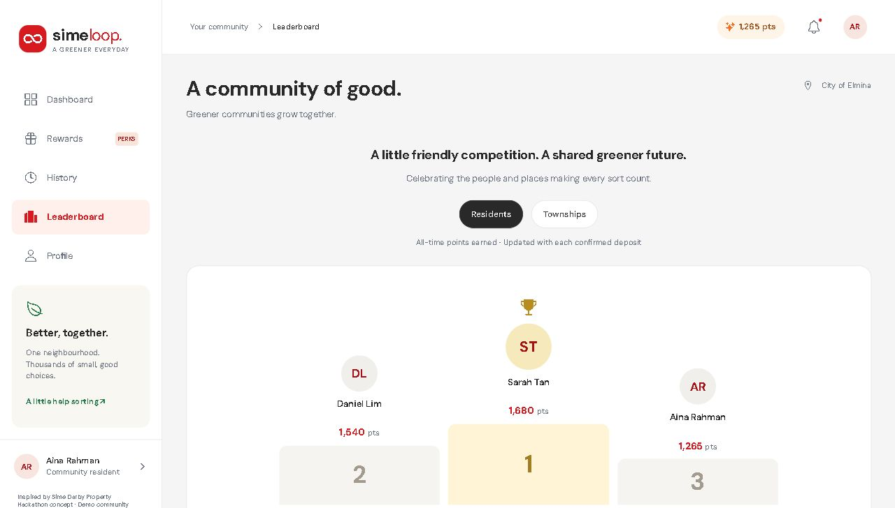

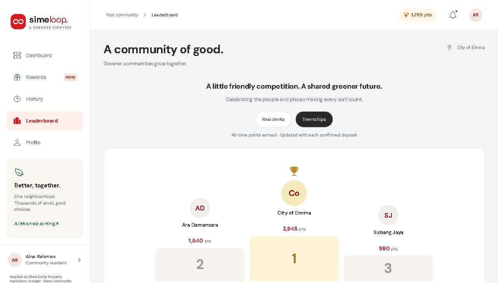

### Profile and role

The profile identifies the resident account and township. The cleaner account uses its own role-specific collection view.

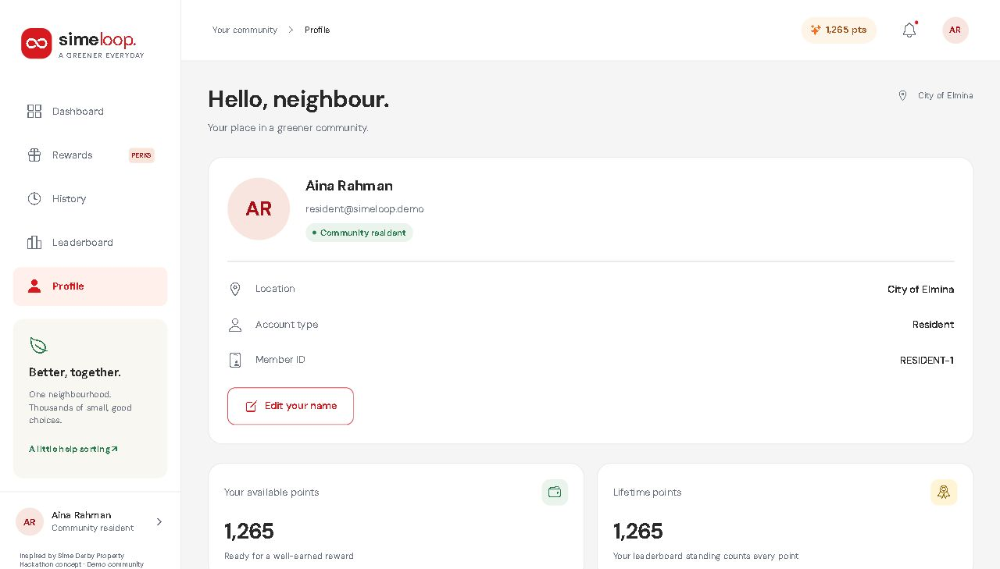

## 6. Cleaner/guard collection queue

When a compartment fills, cleaners in that township receive a task. They acknowledge it, clear the compartment and record completion. Real mode requires fresh below-full sensor evidence; clearing one compartment does not reset the other two.

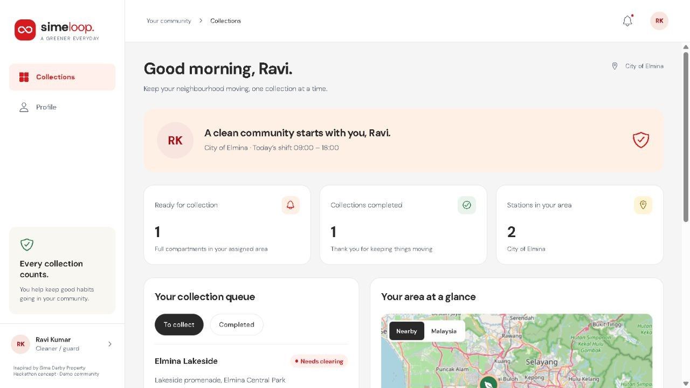

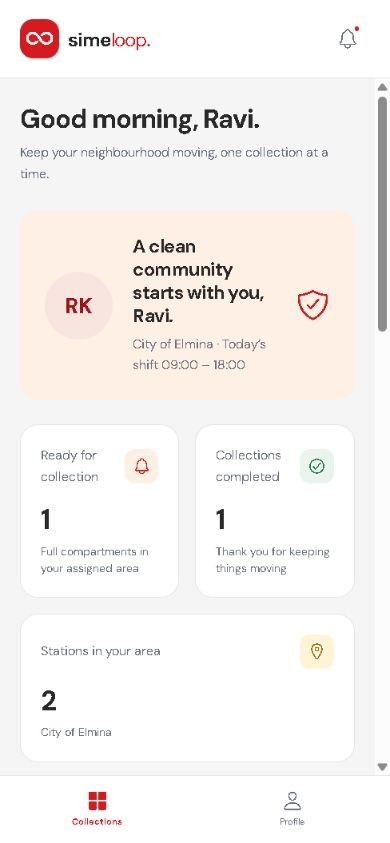

In-app alerts work during the demo. Closed-app remote push requires a configured native Expo project and platform credentials; screenshots do not prove push delivery.

## 7. What is inside the bin

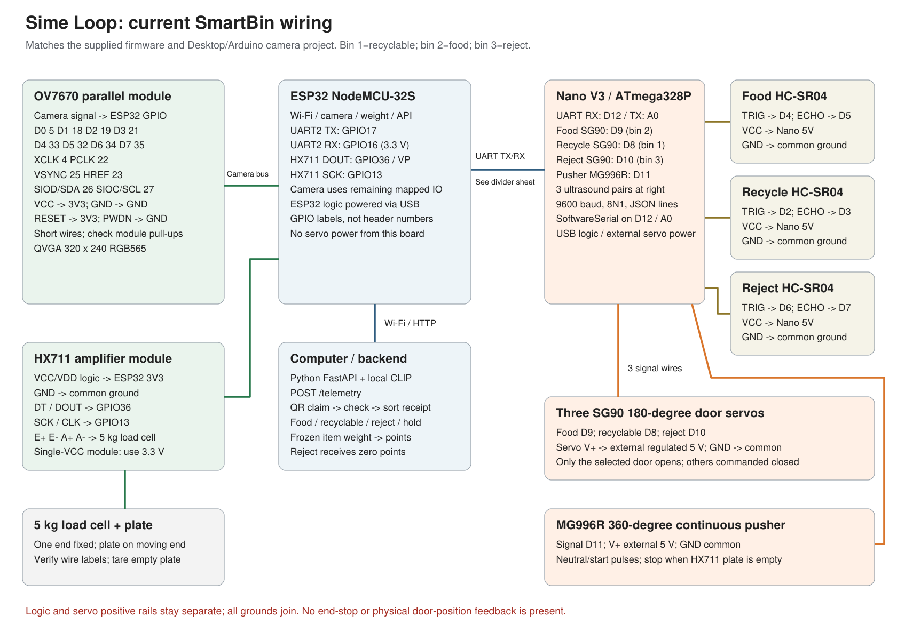

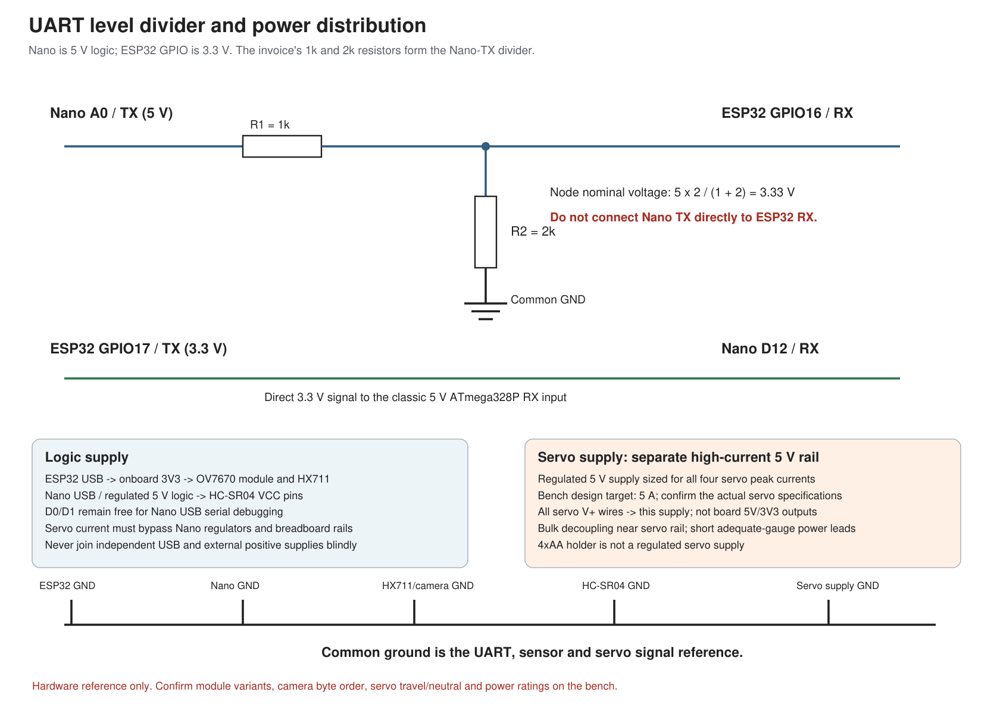

Open the scalable [wiring SVG](../iot/schematics/wiring-overview.svg) and [power/UART SVG](../iot/schematics/uart-and-power.svg) to zoom into labels. Use the [current firmware and protocol handoff](../iot/SMARTBIN_HANDOFF.md); legacy examples have different wiring.

## Demonstration versus real hardware

| Demonstration controls | Real device flow |
| --- | --- |
| Simulated category and entered/sample mass | Captured image and calibrated HX711 readings |
| Software-only completion | Matching controller completion, closed-door commands and stable empty plate |
| Sample collection/fill buttons | Three ultrasonic sensors and area-scoped tasks |
| Illustrative vouchers | Merchant integration is outside this prototype |

The firmware compiles with the included camera driver but has not been flashed or mechanically tested. These visuals explain the intended integrated flow; they do not establish measured sorting accuracy or physical reliability.

[Back to setup and Wi-Fi/hotspot instructions](../README.md)
